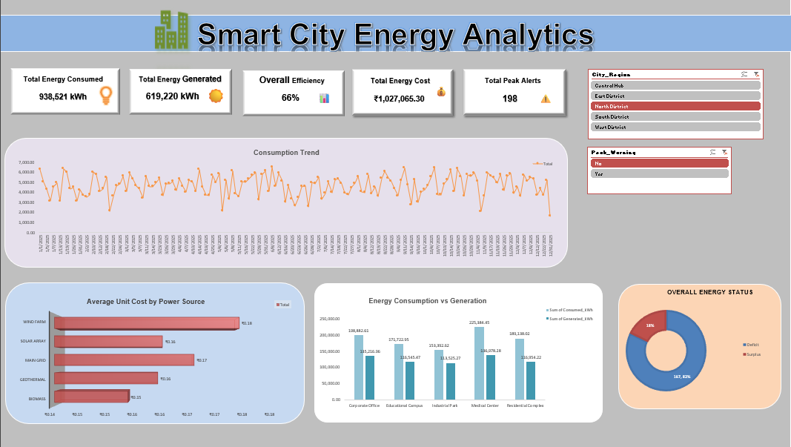

<div align="center">

# ⚡ Smart City Energy Analytics

### 📊 Excel Dashboard for Energy Monitoring & Decision Making

<p>
  
  
  
  
</p>

**Turning raw energy data into clear, actionable insights. ⚡🏙️**

</div>

---

## 🖼️ Dashboard Preview


---


**▶️ Click the image to watch the complete project walkthrough.**

## 🚀 About

**Smart City Energy Analytics** is an interactive Microsoft Excel dashboard built to analyze electricity consumption, generation, cost, efficiency, temperature, and operational alerts across a simulated smart-city environment.

The project combines **data cleaning + calculated columns + PivotTables + KPIs + charts + slicers** into one decision-friendly dashboard.

---

## 📌 At a Glance

| 📊 Dataset | ⚡ Energy | 💰 Cost | 🎯 Efficiency |
|:---:|:---:|:---:|:---:|
| **1,250 Records** | **6.24M kWh Consumed** | **₹1.03M** | **65.65%** |

| 🏙️ Regions | 🏢 Facilities | 🔋 Power Sources | 📈 KPIs |
|:---:|:---:|:---:|:---:|
| **5** | **5** | **5** | **5** |

---

## 🎯 Dashboard Highlights

- ⚡ **Consumption vs Generation** analysis
- 💰 **Energy Cost** monitoring
- 📈 **Energy trend** visualization
- 🏙️ **Region & Facility** comparison
- 🚨 **Peak-demand** monitoring
- 🌡️ **Temperature** analysis
- 🎛️ **Interactive slicers**
- 📊 **Executive KPI cards**

---

## 📈 Key KPIs

| KPI | Result |
|---|---:|
| ⚡ Total Energy Consumed | **6,244,204.55 kWh** |
| 🔋 Total Energy Generated | **4,114,522.02 kWh** |
| 📉 Net Energy Deficit | **2,129,682.53 kWh** |
| 💰 Total Energy Cost | **₹1,027,065.30** |
| 🎯 Average Efficiency | **65.65%** |

### Core Calculation

```text
Efficiency = Total Generated Energy / Total Consumed Energy
```

---

## 🔍 Key Insights

> **Energy demand is currently higher than generation**, resulting in a significant net energy deficit.

- 🔴 **1,028** records → Deficit
- 🟢 **222** records → Surplus
- 🚨 **198** records → Peak-warning condition
- 🌡️ **812** records → Moderate temperature
- 🏙️ Data covers **5 city regions**
- 🏢 Data covers **5 facility categories**

---

## 🛠️ Tech Stack

| Technology | Usage |
|---|---|
| 🟢 **Microsoft Excel** | Dashboard development |
| 📊 **PivotTables** | Data aggregation |
| 📈 **PivotCharts / Charts** | Visualization |
| 🎛️ **Slicers** | Interactive filtering |
| 🧮 **Excel Formulas** | KPI calculations |
| 🎨 **Conditional Formatting** | Alerts & visual analysis |

---

## 🧮 Core Calculations

```text
Net Energy
= Consumed kWh - Generated kWh
```

```text
Energy Cost
= Consumed kWh × Unit Cost
```

```text
Efficiency
= Generated kWh / Consumed kWh
```

```text
Energy Status
= Deficit / Surplus
```

---

## 🔧 Data & Dashboard Improvements

The workbook was also reviewed and improved for reliability:

| Issue | Improvement |
|---|---|
| 💰 Incorrect cost total | Fixed transaction-level cost calculation |
| 🌡️ Temperature labels | Corrected row-reference logic |
| 🚨 Alert text inconsistency | Standardized alert labels |
| 📊 KPI totals | Made calculations filter-aware |
| 🎛️ Slicer errors | Improved error-safe calculations |
| 📅 Chart dates | Corrected date-axis formatting |
| 🎨 Dashboard layout | Cleaned and standardized presentation |

---

## 🔄 Data Flow

```text
             RAW ENERGY DATA
                    │
                    ▼
            DATA VALIDATION
                    │
                    ▼
          CALCULATED COLUMNS
                    │
                    ▼
             PIVOT ANALYSIS
                    │
          ┌─────────┴─────────┐
          ▼                   ▼
       KPI CARDS           CHARTS
          │                   │
          └─────────┬─────────┘
                    ▼
           INTERACTIVE DASHBOARD
                    │
                    ▼
          SMART ENERGY INSIGHTS
```

---

## 📂 Repository Structure

```text
Smart-City-Energy-Analytics/
│
├── 📄 README.md
├── 📊 Smart_City_Energy_Log.xlsx
│
└── 📁 assets/
    └── 🖼️ dashboard-preview.png
```

---

## ▶️ How to Use

1. Download **`Smart_City_Energy_Log.xlsx`**
2. Open it using **Microsoft Excel**
3. Go to the **Dashboard** sheet
4. Use the slicers to filter the analysis
5. Explore KPIs, charts, costs, and energy status

---

## 🔮 Future Scope

- 📊 Power BI dashboard
- 🐍 Python-based automation
- 🗄️ SQL database integration
- 🤖 Energy-demand forecasting
- 🚨 Automated anomaly detection
- 📡 Real-time IoT energy monitoring

---

## ⭐ Project Goal

The goal is simple:

> **Make complex energy data easy to understand and useful for decision-making.**

---

<div align="center">

### ⚡ Analyze. Visualize. Optimize. 🏙️

**Smart City Energy Analytics Dashboard**

⭐ If you like this project, consider giving the repository a star!

</div>
